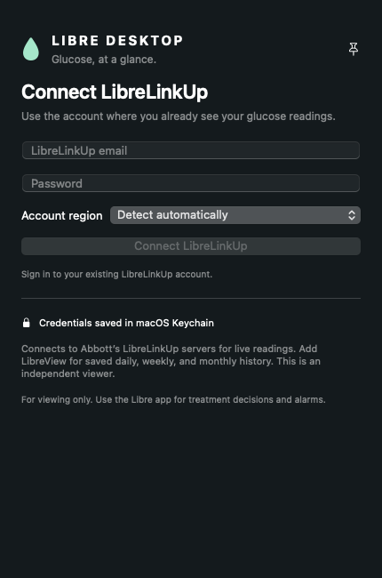
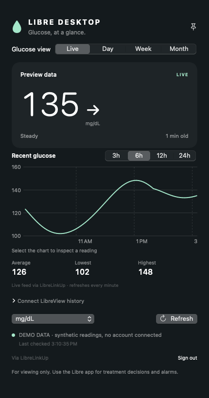
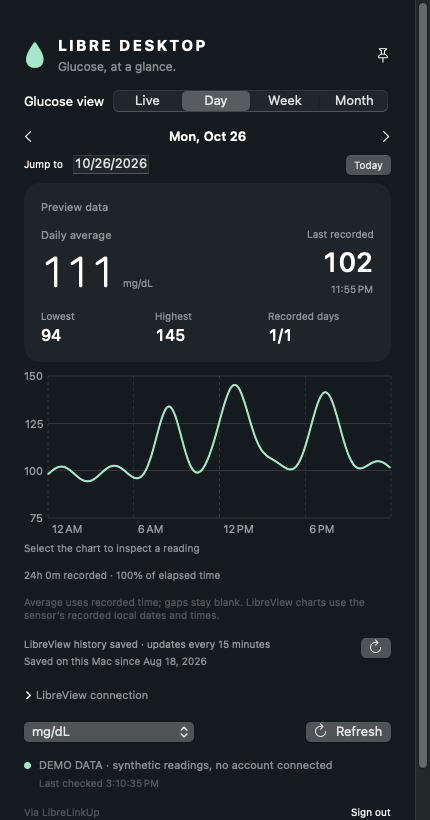
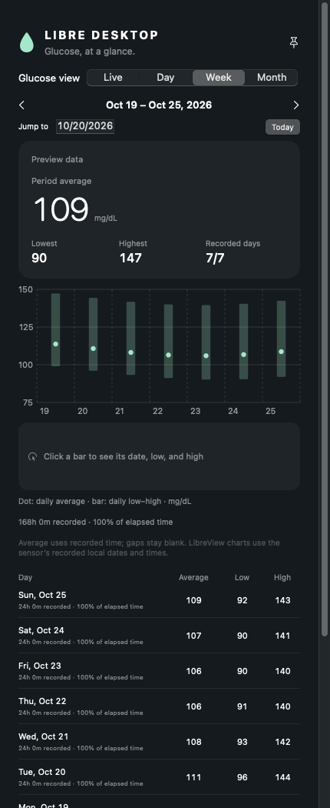
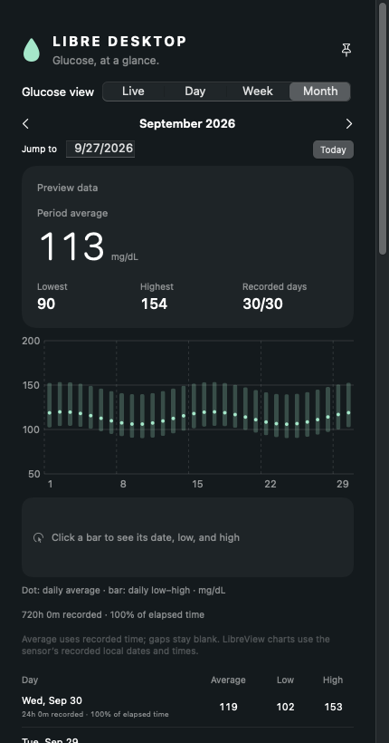

# Libre Desktop

A native macOS glucose viewer with a floating desktop widget, a menu-bar reading, and live, daily, weekly, and monthly charts. Built with Swift, SwiftUI, AppKit, and Charts.

Live readings come from your existing **LibreLinkUp** account. Optional history comes from your **LibreView** account. This project runs independently of Garmin and has no Python or third-party package dependencies.

**[Download the Mac app (.dmg)](https://github.com/sshivaji/libre-desktop/releases/latest/download/Libre-Desktop-0.2.2-universal.dmg)** · [ZIP bundle](https://github.com/sshivaji/libre-desktop/releases/latest/download/Libre-Desktop-0.2.2-universal.zip) · [Release notes and checksums](https://github.com/sshivaji/libre-desktop/releases/latest)

**macOS 14+ · Apple Silicon and Intel · No Xcode or Terminal needed to install**

**This is a desktop app with a widget-style window, not a WidgetKit extension in macOS's “Add Widgets” gallery.** It can appear across Spaces and be pinned above other windows. The app must be running and the Mac awake to refresh.

An independent, unofficial project; not affiliated with Abbott. For reference only, not treatment decisions or replacement glucose alarms. The official Libre app remains the source for treatment decisions and alarms. These cloud services may lag the sensor, and their undocumented interfaces can change.

## Install and connect

1. **Download and drag.** Open the [DMG](https://github.com/sshivaji/libre-desktop/releases/latest/download/Libre-Desktop-0.2.2-universal.dmg), then drag **Libre Desktop.app** to **Applications**. Quit an older copy before replacing it. With the ZIP, unzip and move the app to Applications.
2. **Open and sign in.** Open Libre Desktop and enter the **LibreLinkUp** credentials for the account that already shows your readings. Region detection is automatic.
3. **Add history if you want it.** Expand **Connect LibreView history** and enter your **LibreView website** credentials. Live and historical data use separate sign-ins and work together.

**First launch:** this community build is ad-hoc signed and **not Apple-notarized**. If macOS blocks it because the developer cannot be verified, and you trust this repository's download, try opening the app, then use **System Settings → Privacy & Security → Open Anyway** for Libre Desktop. Managed Macs may restrict this. See [Apple's opening instructions](https://support.apple.com/en-us/102445). The install guide is also included inside the DMG.



## Screenshots

These are captures of the app's actual SwiftUI views, populated with **synthetic example readings**. The live example shows **135 mg/dL**; the charts illustrate realistic variation rather than publishing a person's glucose history. Click an image to view it at full size.

| Live readings | Daily history |
| --- | --- |
| [](docs/images/live.png) | [](docs/images/day.png) |
| Current value, trend, age, and recent chart | Daily average, low/high, and recorded coverage |

| Weekly history | Monthly history |
| --- | --- |
| [](docs/images/week.png) | [](docs/images/month.png) |
| Compare days and inspect each day's range | Review longer trends and navigate past periods |

## Features

- Current glucose, trend, measurement age, and menu-bar reading.
- Live charts covering 3, 6, 12, or 24 hours; mg/dL and mmol/L.
- Daily, weekly, and monthly history with date navigation and selectable chart readings.
- A local history archive, separated by account and person.
- Explicit stale, offline, missing-data, and account-action states.
- Keychain storage for each service's credentials and session.

## Build from source

Requires macOS 14 or later and Apple developer tools with a Swift 5.9+ compiler. Install Xcode or its Command Line Tools (`xcode-select --install`). Apple Silicon is tested on hardware; Intel builds are cross-compiled but not yet tested on Intel hardware.

```sh
git clone https://github.com/sshivaji/libre-desktop.git
cd libre-desktop
bash scripts/test.sh
bash scripts/build.sh
open 'build/Libre Desktop.app'
```

The default build targets the current Mac and uses ad-hoc signing for local development. The downloadable release is also ad-hoc signed; there is no notarized or App Store release yet. Building from source requires no developer account, private signing key, or account credentials.

Build a universal app with `LIBRE_ARCHS="arm64 x86_64" bash scripts/build.sh`. For your own signed distribution, set `LIBRE_SIGNING_IDENTITY` to an identity already in your Keychain; signing alone does not notarize the app.

To install a build, quit any running copy, then copy `build/Libre Desktop.app` into `~/Applications`. A different signing identity may require signing in again or approving Keychain access. The bundle identifier is retained from the original local app for compatibility.

## Use

1. Open Libre Desktop and sign in with the LibreLinkUp account that already shows your readings. Region detection is automatic, with a manual choice available.
2. If that account follows multiple people, choose whose readings to display.
3. Optionally expand **Connect LibreView history** and sign in with the website account. This login is stored separately.
4. Choose **Live / Day / Week / Month**, inspect a reading in the chart, or navigate to earlier dates. Use the pin button to keep the window above other apps.

Closing the window leaves the menu-bar app running. Use **Show glucose widget** to reopen it or **Quit Libre Desktop** to stop it. Launch with `open 'build/Libre Desktop.app' --args --background` to start without opening the window. Automatic launch at login is not configured by the app.

The live feed refreshes every minute while awake. Readings older than five minutes are marked stale. LibreView loads 90 days at startup, wake, and manual refresh; recent history refreshes every 15 minutes. Empty periods can request their history explicitly. Reports use the currently active device, so earlier devices may require their own report.

If the service requests account verification or acceptance of terms, complete that action in the official app or website and retry. This app does not accept terms on your behalf. Rate limits trigger backoff.

## Data and privacy

Credentials, tokens, and the selected LibreLinkUp connection stay in macOS Keychain. History is stored in owner-only SQLite files under `~/Library/Application Support/Libre Desktop/History`. Signing out removes that service's credentials and hides its data, but retains the local archive. To remove the archive, quit the app and remove that folder yourself.

Requests go only to allowlisted Abbott service and report hosts. Credential-bearing redirects are not followed. Report HTML is parsed as data without running JavaScript. Raw reports and session-bearing report URLs are not saved. `status.json` in the application-support directory contains operational metadata, not glucose values, identity, or credentials. There is no analytics or telemetry, and Bluetooth and Full Disk Access permissions are not needed.

Charts retain missing intervals and original measurement dates. LibreView device wall time and LibreLinkUp UTC time are handled separately. Averages use recorded coverage without interpolating large gaps; missing readings do not become zeroes.

## Development

`bash scripts/test.sh` runs model, client, calendar, report-parsing, and archive checks locally using synthetic data and mock responses. It does not access an account or the network. Use `LIBRE_ARCHS="arm64 x86_64" bash scripts/build.sh` to build both CPU architectures locally. This repository does not use GitHub Actions. Successful mock tests do not establish current live-service compatibility.

`bash scripts/render-previews.sh` generates synthetic screenshots under `build/previews` without restoring accounts or fetching readings. See [CONTRIBUTING.md](CONTRIBUTING.md) before submitting a change.

`bash scripts/package-release.sh` builds both CPU architectures locally and creates a DMG, ZIP, install guide, and SHA-256 checksums under `build/releases/<version>`. Release assets contain the app and public documentation, with no credentials or local archives. No GitHub Actions are used.

The source was separated from the local Epix Desktop workspace. The standalone project contains only the Libre app, tests, and build tools; no personal readings, account exports, or signing material are included.

## License

[GNU Affero General Public License v3.0](LICENSE), preserving the original project's license. Protocol references and acknowledgments are listed in [THIRD_PARTY.md](THIRD_PARTY.md). FreeStyle, LibreLinkUp, and LibreView are Abbott names; the app icon is drawn by this project's build script.
